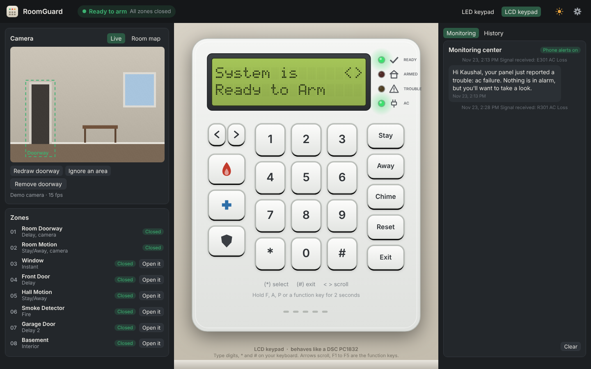
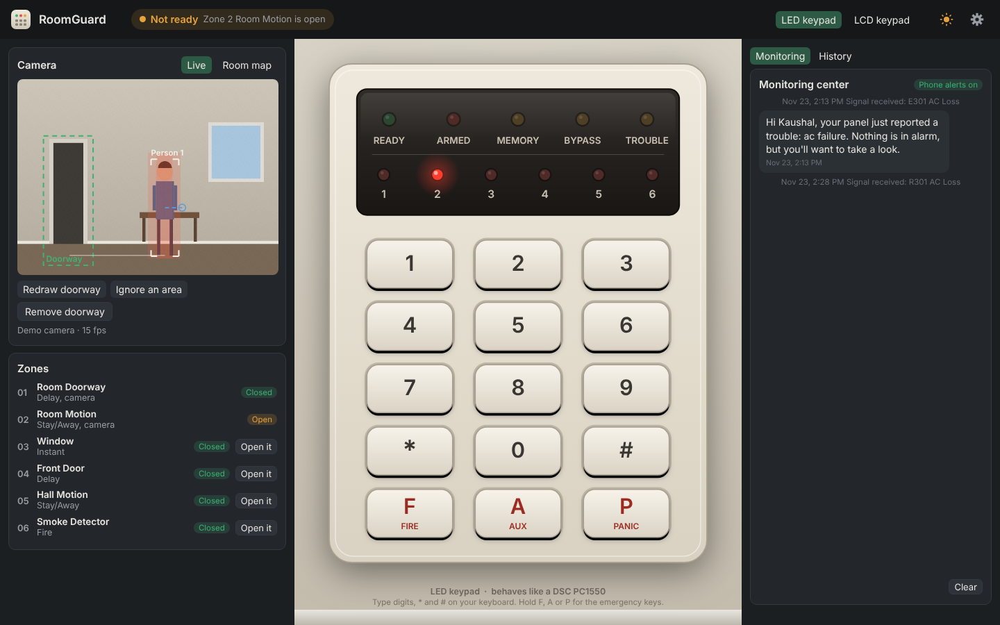
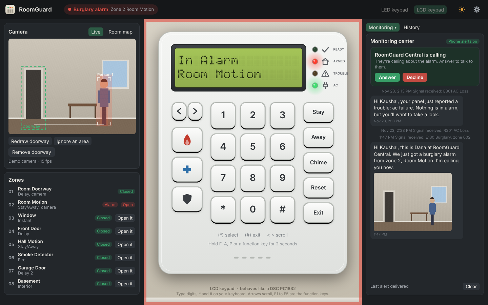
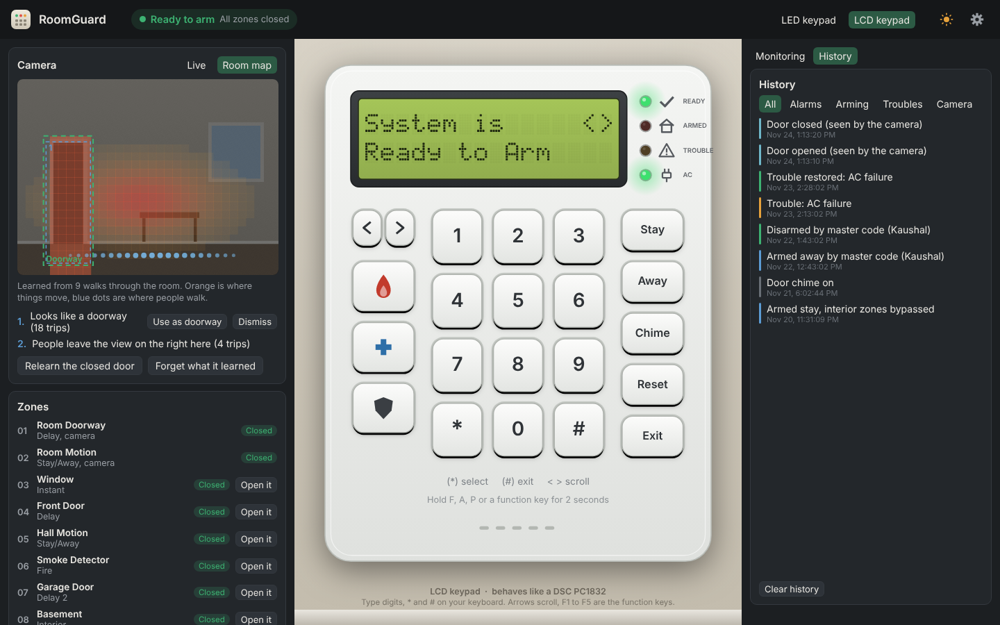

# RoomGuard

**A room alarm that turns your webcam into real alarm sensors**, run from faithful emulations of two classic security panels: a DSC PC1550 with an LED keypad and a DSC PowerSeries PC1832 with an LCD keypad. It watches the doorway, learns how people move around your room, follows intruders, sounds a properly modelled siren, and a monitoring center messages and calls you, with alerts and camera snapshots on your phone.



| The LED keypad | An alarm |
| --- | --- |
|  |  |
| Zone 2's light is on because the camera is tracking someone walking through the room, with their predicted path in blue. | The panel reported a burglary. The operator sent the snapshot and is calling. |



*The room map: where things move (orange), where people walk (blue) and the doorway they use, all learned by watching.*

## What it does

- **Two real panels, emulated.** Key sequences, lights, LCD screens, entry and exit delays, bypassing, troubles, alarm memory, user codes and installer programming follow the panels' own manuals, down to the real section numbers. See [the programming reference](docs/PROGRAMMING.md).
- **Your webcam is the sensor.** The doorway is zone 1 with an entry delay and the rest of the room is zone 2. Anyone who shows up in the room without coming through the doorway sets off an instant alarm, exactly like a real interior zone.
- **It learns the room.** It works out where people come in and leave, which spots move by themselves (a TV, a fan, curtains) and what the door looks like shut, so an open door trips the alarm even when nobody is in view.
- **It follows people.** Every person gets a motion filter that predicts where they're heading. Pan and tilt cameras aim ahead of fast movers, and when someone gets away they check where that person was heading, then the doorways and the paths people usually take from there.
- **Faces, offline.** Teach it your face and it can disarm for you during the entry delay. Nothing is uploaded.
- **Hardware that sounds right.** The keypad buzzers and four sirens (Ademco WAVE-2F, Klaxon Master Blaster, ADT RX-7C and a motor bell) are synthesized live from physical models of how each one makes sound.
- **A monitoring center.** The communicator dials out with real Contact ID or pulse format tones, then an operator messages you, calls, asks for your passcode and dispatches or cancels. Dispatching is simulated; nobody is ever sent.
- **Alerts on your phone**, with snapshots, through the free ntfy app. No account needed.
- **Hard to turn off by accident.** Closing it while armed needs your code. After a crash or power cut it comes back armed, and it can keep the computer awake while armed.
- **No webcam? Use the demo camera.** It shows a drawn room with someone walking in and out, running through the same pipeline as a real camera.

## Download and first launch

Get the latest build for your computer from the [Releases page](../../releases).

**Windows.** Run `roomguard-windows-x86_64.exe`. Because the download isn't code signed yet, Windows SmartScreen may say "Windows protected your PC". Choose **More info**, then **Run anyway**. You only need to do this once.

**macOS** (Apple Silicon and Intel). Open the `.dmg` and drag RoomGuard into Applications. It isn't notarized by Apple, so the first time, Control click RoomGuard and choose **Open**, or open it once and then choose **Open Anyway** in System Settings, Privacy and Security. Allow camera access when asked.

**Linux** (x86_64). Make it executable and run it:

```sh
chmod +x roomguard-linux-x86_64
./roomguard-linux-x86_64
```

The first launch walks you through setup: your name, which keypad, your master code, the camera, phone alerts and whether to open at sign in.

## Phone alerts in five minutes

RoomGuard sends alerts through [ntfy](https://ntfy.sh), a free, open source push notification service. There's no account to create.

1. In RoomGuard, turn on **Send alerts to my phone**. The setup wizard offers it, or go to **Settings**, then **Monitoring**.
2. Install the **ntfy** app on your phone. Links for Android (Google Play and F-Droid) and iPhone (App Store) are on [ntfy.sh](https://ntfy.sh).
3. In the app, tap **+** and subscribe to the topic RoomGuard shows you, or scan the QR code next to it. Leave the server as `ntfy.sh`.
4. Press **Send a test alert**. It should arrive within a few seconds.

You'll get alarms with the camera snapshot (urgent priority), troubles like the laptop being unplugged or the camera being covered, and a warning if RoomGuard is closed while armed. In Settings you can also get a heads up when an entry delay starts, or a message every time it's armed and disarmed.

Your topic name works like a password: anyone who knows it can read your alerts. RoomGuard makes a long random one, and **New topic** makes another. If you'd rather keep everything on your own server, run ntfy yourself and enter its address and access token in Settings.

## Using it

### Arming and disarming

- **Arm:** type your code, then leave through the doorway before the exit delay ends. The panel arms away.
- **Stay at home:** arm and don't leave (or hold **Stay** on the LCD keypad). The room zone is bypassed so you can move around, and the doorway stays armed with its entry delay.
- **Disarm:** come back in and type your code before the entry delay runs out. If you've taught it your face, it can disarm for you.
- **Emergencies:** hold **F**, **A** or **P** for fire, medical or panic.

### The camera and the doorway

On the camera card, press **Mark the doorway** and drag a box around it, or let RoomGuard spot it: after a few people walk through, the **Room map** tab suggests the doorway and you just press **Use it**. You can also tell it to ignore an area, such as a TV. Until a doorway is marked, the whole view is zone 1.

### Pan and tilt cameras

Pick your camera type in **Settings**, then **Camera**: a USB pan and tilt webcam (Windows and Linux) or an OBSBOT through OBSBOT Center's OSC remote (every system). Then open **Room map** and press **Map the room** once. The camera sweeps the room, measures how far it really turns, and stitches a panorama that the map is drawn on.

### Keyboard

| Keys | Keypad key |
| --- | --- |
| `0` to `9`, `*`, `#` | The same keys |
| Hold `F`, `A`, `P` | Fire, auxiliary, panic |
| `Enter` or `Esc` | `#` |
| Left and right arrows | `<` and `>` (LCD keypad) |
| `F1` to `F5` | Stay, Away, Chime, Reset, Exit (LCD keypad) |

## Staying on guard

- **Closing while armed needs your code.** The window asks for it, or you can minimize instead. Wrong codes count toward the keypad lockout, which also saves a snapshot of whoever is guessing.
- **It comes back armed.** If RoomGuard is shut down some other way (Task Manager, a crash, a power cut), it re-arms the next time it starts and tells you on your phone, just like a real panel after a power cut.
- **Open at sign in** is an option in setup and in Settings, so it comes back after a restart.
- **Keep the computer awake while armed** stops the computer from sleeping while it's watching.

These use only ordinary, documented features. RoomGuard never hides from the task manager, never needs administrator rights, never blocks other programs and only starts at sign in if you turn that on, using the normal per user setting: the Run key for your account on Windows, a LaunchAgent on macOS, an autostart entry on Linux. The only reason Windows or macOS warns on first launch is that the downloads aren't code signed. Signing certificates cost money; if you get one, add a signing step to `.github/workflows/release.yml` and the warning goes away.

## Where your data lives

Settings, codes (salted and hashed), faces, the room map and history are saved in a data folder that deleting or updating the app never touches:

- Windows: `%APPDATA%\RoomGuard`
- macOS: `~/Library/Application Support/RoomGuard`
- Linux: `~/.local/share/RoomGuard`

Every save is written to a temporary file and renamed into place, so a crash can't leave a half written file, and the previous good copy is kept as a backup.

## Updates

RoomGuard checks GitHub for a newer release when it starts, shows you the release notes, and asks before downloading anything. On Windows and Linux it replaces itself and asks you to restart. On macOS it opens the new disk image so you can drag it into Applications.

## Building from source

Install Rust from [rustup.rs](https://rustup.rs), then:

```sh
cargo run --release
```

On Linux, install the build packages first:

```sh
sudo apt-get install pkg-config clang libasound2-dev libudev-dev libv4l-dev \
  libxkbcommon-dev libxcb-render0-dev libxcb-shape0-dev libxcb-xfixes0-dev libgl1-mesa-dev
```

`cargo test` runs the test suite: arming, delays, alarms, bypassing, troubles, programming, the communicator's Contact ID checksum, frame decoding, tracking and prediction, room map learning, every siren model and more. GitHub Actions runs it on Windows, macOS and Linux for every push. The first build creates `Cargo.lock`; commit it so every build uses the same versions.

## Releasing

1. Add a section for the new version at the top of `CHANGELOG.md`.
2. Change `version` in `Cargo.toml`.
3. Push a tag, such as `git tag v2.0.1 && git push origin v2.0.1`.

The release workflow tests and builds Windows, macOS (universal) and Linux, and publishes a release with that version's changelog section as its notes. The installed apps find it through the update check.

To refresh the screenshots in this README, run the **Screenshots** workflow from the Actions tab. It runs the app with its demo camera on a virtual screen and commits new pictures.

## Honest limits

- One camera can't measure depth, so the room map is learned from what the camera sees, not a 3D floor plan.
- Doorway detection needs to watch people use the door a few times. You can always mark it by hand.
- Face recognition uses a classic method that works well for the same camera in the same room, but it's not as robust as large online face models. The liveness check blocks a photo held still, not a photo waved around.
- DSC doesn't publish its keypad buzzer frequencies, so those tones are close estimates. The sirens follow their published specifications.
- This is a fun and useful room alarm, not a certified security system. Don't rely on it to protect life or property.

## License

Copyright 2026 Kaushal Bhingaradia. Licensed under the [Apache License 2.0](LICENSE). See [NOTICE](NOTICE) for third party credits.

RoomGuard emulates how the DSC PC1550 and PC1832 behave. It isn't made by, endorsed by or affiliated with DSC or any other manufacturer named here. The keypads drawn in the app are original designs.
